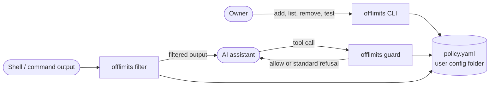
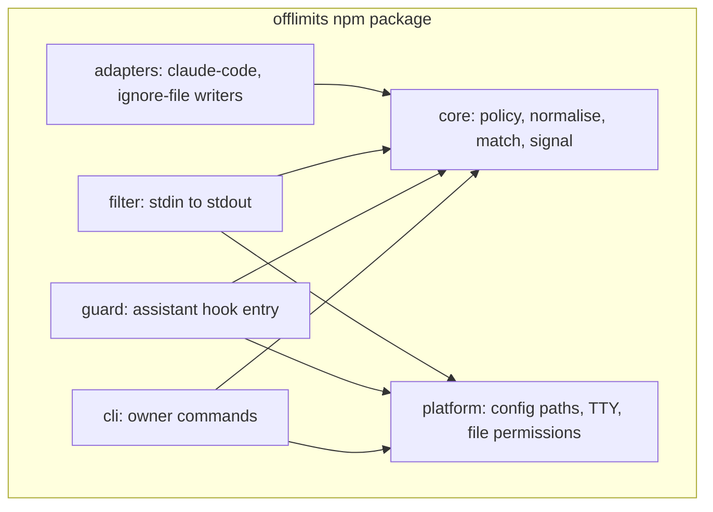
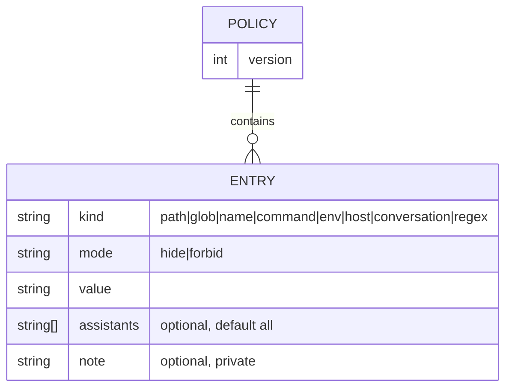
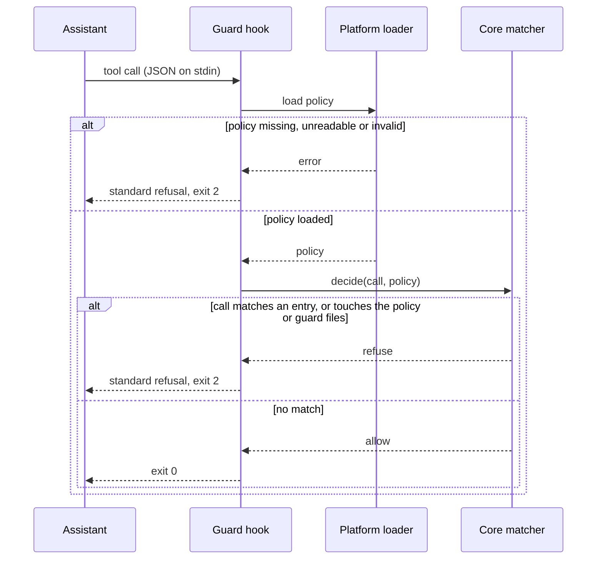
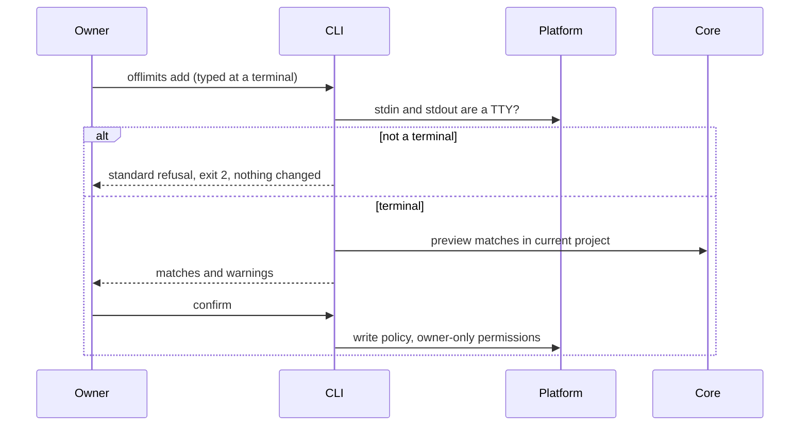

# Architecture

Status: planned (nothing built yet). Decisions are in `docs/adr/`.

## Stack and rationale

TypeScript (`strict`) on Node 22 LTS or newer, built with `tsc`. Vitest for tests, ESLint and Prettier for quality. `yaml` and `zod` for the policy file. Everything else is the Node standard library. See ADR 0001.

## Context



## Containers (one package, four entry points)



Rules:

- `core` is pure: no file system, no process, no network. It takes a policy object and a string, and returns a decision. This is the functional core.
- `platform` is the only layer that touches the operating system. It sits behind small interfaces that tests replace with fakes.
- `adapters` translate between an assistant's hook format and `core`. They are thin and versioned, so a format change touches one file.
- Entry points never contain business rules.

## Folder structure

Built through M1 (marked with a tick); the rest is planned.

```
src/
  core/          ✔ policy schema, normaliser, matchers, path and glob rules, warnings, signal
  platform/      ✔ config path, policy file store, project scanner, terminal, match context
  cli/           ✔ run.ts (dispatch), deps.ts (injected dependencies), commands/ (init, add,
                   list, remove, check), main.ts (entry point). Later: count, snippet, install, test
  guard/         hook entry point: read call, decide, refuse or allow
  filter/        stream filter entry point, fail-closed
  adapters/      claude-code/, ignore-files/ (M5), isolation/ (M6)
tests/
  unit/          ✔ core, commands (with fake dependencies) and platform (temporary folders)
  integration/   ✔ the built program run without a terminal, as an assistant's shell would
  helpers/       ✔ fake match contexts and fake dependencies
  adversarial/   workaround classes used by `offlimits test`
docs/
```

Organise by feature if `src/` grows past a handful of modules per folder.

## Data model



The policy file is validated with a schema at the boundary and typed inward. Types are derived from the schema.

## Matching

The rules for each kind, and their limits, are in [ADR 0005](adr/0005-matching-rules-per-kind.md). In outline:

1. `decide(policy, text, context, assistant?)` checks every entry that applies to the assistant.
2. Names are compared after normalising (Unicode NFKC, lower-case, space, `-` and `_` removed). Paths and globs are compared as resolved paths, as written and with links followed. Commands, environment variables and hosts are compared as whole words. Regular expressions run on the raw text.
3. It returns `{ blocked: false }` or `{ blocked: true, mode }`. The entry that matched is never returned.

## Critical flow: a guarded tool call



## Critical flow: owner edits the policy



## Cross-cutting concerns

- **Errors:** specific error types. Anything that touches the guard or filter path ends in the standard refusal or an empty output. Users see a short message and the exit code. Details go to a debug log that never contains entry values.
- **Logging:** counters only (blocked, filtered). No names, no matched rule, no raw tool input.
- **Configuration:** `OFFLIMITS_POLICY` (policy path) and `OFFLIMITS_DEBUG` (debug log on). Validated at start-up.
- **Security model:** see `docs/THREAT-MODEL.md` (written in M4). In short: the guard and filter reduce accidental exposure and the isolation layer enforces. The policy file is owner-only, edited only from a terminal, and protected from reads by the guard.
- **Performance:** one process per hook call. Budget of 100 ms. The matcher is linear in policy size and has no network or disk access beyond reading the policy.
- **Testing seam:** `platform` interfaces are replaced by fakes in unit tests. Integration tests run the real entry points against a temporary policy with made-up names.

## External services

None. The tool works offline and sends nothing anywhere.
